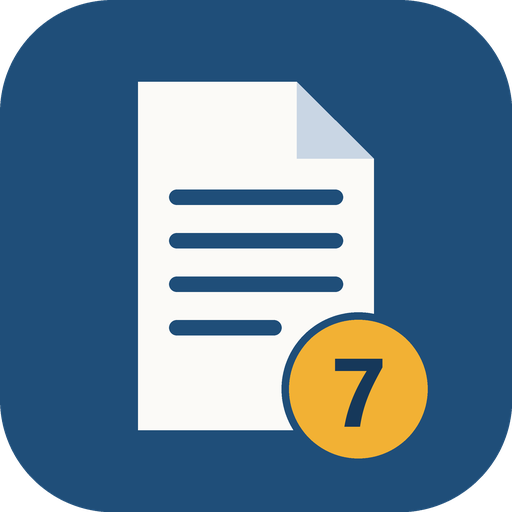

<p align="center"></p>

<h1 align="center">apa-kit</h1>

<p align="center"><b>Tu tesis en formato APA 7, con tu asistente de IA.</b><br>
Skills para Claude, Codex y otros agentes · Markdown → Word · cualquier carrera<br>
<a href="https://jhoel0521.github.io/apa-kit/">Sitio</a> · <a href="https://github.com/jhoel0521/apa-kit/releases/latest">Descargar</a> · <a href="docs/guia-estudiantes.md">Guía para estudiantes</a></p>

Skills para que un agente de IA (Claude Code, Cowork, Codex…) cree y versione **documentos académicos en
formato APA 7**: tesis, trabajos de curso, artículos e informes, de cualquier carrera. Los capítulos viven
en Markdown, un script los convierte en Word con formato APA 7 y git guarda cada versión.

**No hay que descargar una plantilla ni saber programar.** Instalas las skills, le dices al agente
«quiero escribir mi tesis» y él prepara el proyecto, te hace las preguntas y genera el Word.

## Por qué así
- Un documento largo es difícil de sostener en el contexto de un agente. Con **un archivo `.md` por capítulo**
  el agente lee y edita solo lo que toca.
- **Git + Markdown** = cada cambio es una versión pequeña y reversible: tantas versiones como necesites.
- **El mismo estándar para todos**: el motor no sabe de ingeniería ni de filosofía. Cada tipo de documento
  trae su estructura con marcas `[[…]]` neutras, y el índice lo decide tu institución.
- **Los datos personales no se versionan**: viven en `.env`, que git ignora.

## Instalar

| Uso | Cómo |
|---|---|
| **Claude Code** (plugin) | `/plugin install apa-kit --marketplace jhoel0521/apa-kit` |
| **Claude Code, Codex, Cursor, Copilot, Gemini…** | `npx skills add jhoel0521/apa-kit` (elige las skills y los agentes) |
| **Cowork o claude.ai** (sin programar) | Descarga `apa-kit-cowork.zip` de [Releases](https://github.com/jhoel0521/apa-kit/releases) y súbelo en *Configuración → Skills*. Es **una sola skill** con todo adentro |
| **A mano** | Copia las carpetas de `skills/` a la carpeta de skills de tu agente (`.claude/skills/`, `.agents/skills/`…) |

Necesitas **Python 3.9 o superior** en el equipo donde el agente ejecuta comandos (Windows, macOS o Linux;
iPhone y iPad no sirven). La primera vez, `apa-init` instala `python-docx` y `Pillow` por ti.

### Si tu agente no admite skills
Pégale esto, con la carpeta de trabajo abierta:

```text
Quiero escribir un documento en formato APA 7 con apa-kit. Clona https://github.com/jhoel0521/apa-kit
(git clone --depth 1) en una carpeta TEMPORAL fuera de mi proyecto, lee skills/apa-guia/SKILL.md y
skills/apa-init/SKILL.md, y sigue apa-init paso a paso usando esa carpeta como ASSETS
(skills/apa-init/assets). No escribas dentro de la carpeta clonada; todo se crea en mi carpeta de trabajo.
Pregúntame antes de instalar algo y no inventes datos ni referencias.
```

## Usarlo
Abre el agente en una carpeta de trabajo y dile lo que quieres, con tus palabras:

| Dices… | Skill |
|---|---|
| «Quiero escribir mi tesis en formato APA» · «actualiza apa-kit» | `apa-init` |
| «Ya tengo mi tesis en Word, pásala a APA» | `apa-importar` |
| «Ayúdame con mi introducción» · «agrega esta tabla» | `apa-escribir` |
| «¿Qué me falta?» · «¿están bien mis citas?» | `apa-revisar` |
| «Genera mi Word» · «¿cuánto llevo?» | `apa-generar` |
| «¿Cómo cito una figura?» · reglas y sintaxis | `apa-guia` |

En Claude Code también puedes invocarlas con `/apa-init`, etc. Guía paso a paso para estudiantes que no
programan: [`docs/guia-estudiantes.md`](docs/guia-estudiantes.md).

## Tipos de documento

| Tipo | Para | Formato por defecto |
|---|---|---|
| `tesis` | Tesis de cualquier carrera | Capítulos numerados, cada uno en página nueva, con índice y listas |
| `tesis-software` | Tesis de sistemas o software | Como `tesis`, con análisis, diseño, implementación y pruebas |
| `trabajo-estudiante` | Ensayo, monografía, trabajo de curso | Portada de estudiante APA 7, sin índice ni numeración |
| `articulo` | Artículo o trabajo profesional | Encabezado con título corto, nota del autor, Método/Resultados/Discusión |
| `informe` | Informe técnico, de práctica o de proyecto | Secciones numeradas con índice |
| `libre` | Cualquier otro; el índice lo dicta tu institución | Sin numerar, sin saltos de página |

Todo se ajusta después en `documento.toml` (numeración, saltos de página, fuente, papel, «Cuadro» en vez de «Tabla»…).

## Qué crea en tu carpeta
```
tu-carpeta/
├─ .apa/scripts/        el motor (lo copia apa-init; no se edita)
└─ tesis/               un documento (puedes tener varios)
   ├─ documento.toml    título, formato, portada
   ├─ capitulos/*.md    un archivo por capítulo
   ├─ recursos/         figuras, diagramas, logo
   ├─ .env              tus datos personales (git lo ignora)
   └─ dist/             el Word generado (git lo ignora)
```
El Word se actualiza regenerándolo. **Si lo editas a mano en Word, apa-kit se niega a sobrescribirlo**
(renómbralo o cambia `salida` en `documento.toml`).

## Si usabas la plantilla anterior
Hasta `v0.1.0` este repositorio era una plantilla que se clonaba dentro de `docs/`. Desde `v0.2.0` es un kit de
skills y esa forma de uso **ya no existe**. Tienes dos caminos:
- Seguir con la plantilla vieja: descarga [`v0.1.0`](https://github.com/jhoel0521/apa-kit/releases/tag/v0.1.0)
  (los enlaces a `main.zip` y `git clone` ahora traen el kit nuevo).
- Pasar al kit: instala las skills y pide «migra mi documento a apa-kit». Tu contenido no se toca; el
  documento sale igual que antes.

## Desarrollo
Ver [`CONTRIBUTING.md`](CONTRIBUTING.md). Prueba completa: `python3 tests/prueba_humo.py`.
Paquetes: `python3 herramientas/empaquetar.py`.

## Licencia y créditos
MIT, ver [`LICENSE`](LICENSE). El motor nació del generador del proyecto StudyPlan; la estructura y los
scripts se crearon con asistencia de Claude Code (Anthropic) y fueron revisados por el autor. El formato de
skills sigue el de [ux-kit](https://github.com/jhoel0521/ux-kit).
