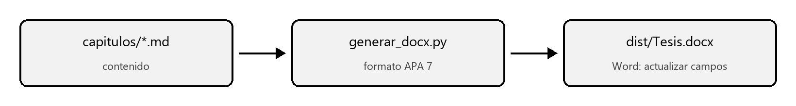

# Marco Teórico {#marco}

<!-- Este capítulo muestra toda la sintaxis admitida. Reemplaza el texto por el tuyo. -->

## Conceptos fundamentales

Un párrafo es un conjunto de líneas seguidas; una línea vacía empieza otro párrafo. Se admite
**negrita**, *cursiva*, `código` y [[texto pendiente]] resaltado en amarillo para no olvidarlo.
Las citas siguen APA 7 y se escriben a mano (Autor, año); cada una debe figurar en Referencias
(American Psychological Association [APA], 2020).

Las referencias cruzadas se numeran solas: el flujo está en @figura:flujo, las herramientas en
@tabla:herramientas y los alcances en la @sec:alcance del @sec:intro.

> Una cita textual de 40 palabras o más va en bloque, sin comillas y con sangría, seguida de la
> referencia entre paréntesis al final del texto citado. (Autor, año, p. 12)

## Herramientas

Tabla: Herramientas del entorno de documentación {#herramientas anchos=4,3,9.5}

| Herramienta | Versión | Uso |
|---|---|---|
| Python | 3.11 o superior | Ejecuta los scripts de `docs/scripts/` |
| python-docx | 1.1 o superior | Escribe el documento en formato APA 7 |
| Git | 2.x | Historial de versiones de los capítulos |

Nota: Las versiones mínimas se validan con `verificar_entorno.py`.

## Flujo de trabajo

{#flujo ancho=15}

Nota: Elaboración propia con `docs/scripts/diagramas.py`.

\newpage

## Ejemplo de código

```
python docs/scripts/generar_docx.py --estado
```
